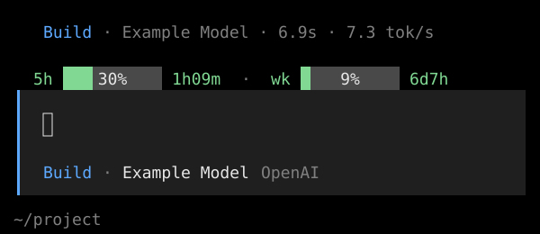
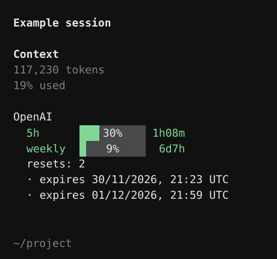
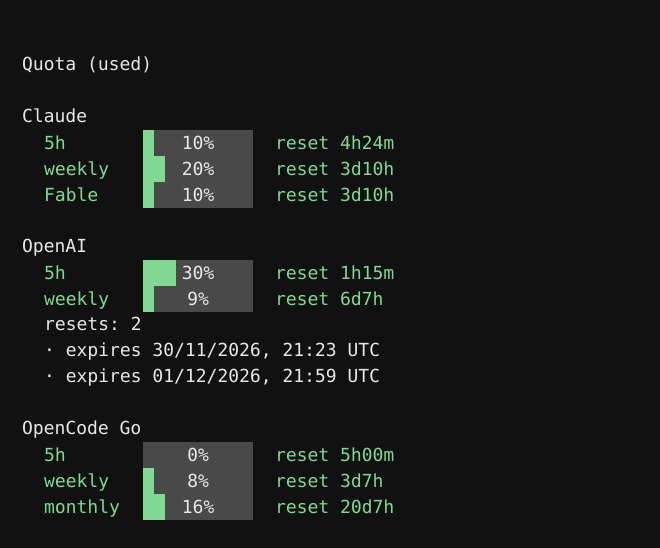
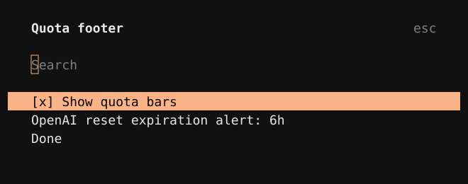

# OpenCode Quota

See your subscription usage and reset times for Claude, OpenAI, and OpenCode Go
in the OpenCode V2 terminal interface.

## Installation

Once the package is published, add it to `opencode.jsonc`:

```jsonc
{
  "$schema": "https://opencode.ai/config.json",
  "plugins": ["@jlreguera/opencode-quota@0.1.0"]
}
```

## Features

### Current model quota

Usage bars and reset times for the current model appear above the prompt:



When the sidebar is open, the quota appears there instead:



### All providers

Use `/quota` to view available quotas for all supported providers:



### Display settings

Use `/quota-footer` to show or hide the bars and set an alert for expiring
OpenAI resets:



All examples show sample data. Responses are cached, and provider retry
intervals are respected.

Claude uses local Claude Code credentials; OpenAI and OpenCode Go use their
OpenCode connections. The plugin sends the relevant credentials to each
provider to retrieve usage. These endpoints are unofficial and may change or
stop working.

## License

[MIT](LICENSE)
